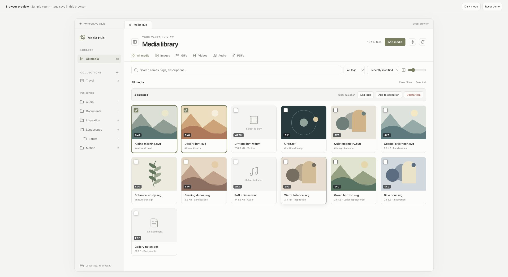
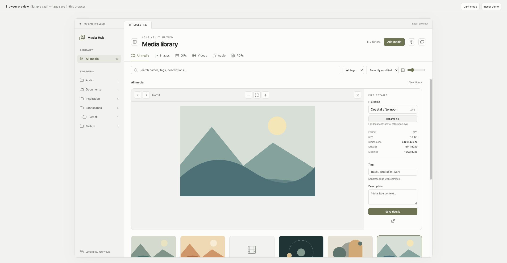
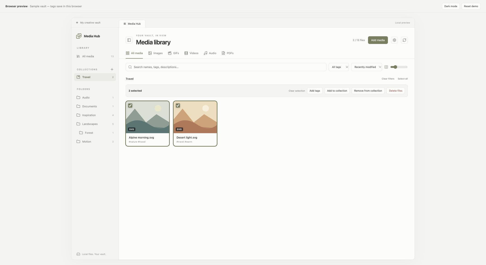
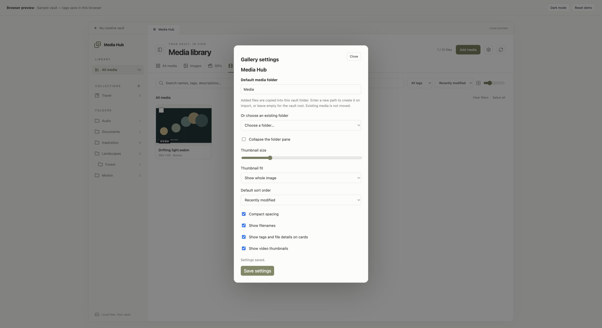
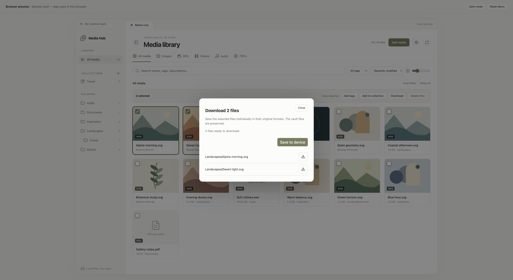
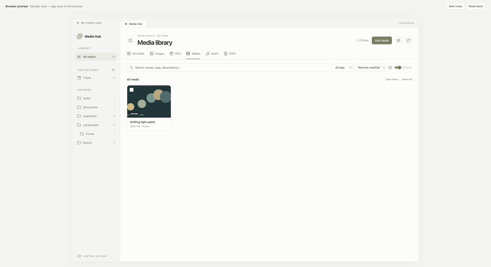

# Media Hub



Media Hub brings your vault's images, GIFs, videos, audio, and PDFs into one searchable media library. Browse by folder, filter by type or tag, and adjust the grid to see your media the way you prefer. Select individual files or Shift-click a range to add tags, organize collections, or delete files together.



Select any item for a larger preview and file details. Zoom into images, play video and audio, rename files, and add tags or descriptions without leaving the gallery. Tags stay attached when files are renamed while the plugin is running.



Create named collections such as Travel or References. One file can belong to several collections without moving or copying it. **Remove from collection** changes only that collection; **Delete files** asks for confirmation with the count and file paths, then uses Obsidian’s configured trash handling.

Screenshots use sample media in the browser preview. The plugin follows your Obsidian theme.



Choose a default folder for added media from the gallery's gear button or **Settings → Media Hub**. Pick an existing vault folder, enter a new folder path, or leave the path empty to use the vault root. The folder pane can be collapsed to give your media more room. Personalize thumbnail crop or fit, compact spacing, filenames, card details, video thumbnails, and the default sort order.



Save media copies to your device from the selection toolbar or expanded preview. Each file keeps its original format. On desktop, use individual save buttons or save the selection. On Android, save directly into a new folder inside Documents/Media Hub; the dialog reports the destination and any failed copies.



Video cards show an early frame where the device supports the codec. Playback starts only after opening the preview; thumbnail generation can be disabled in settings.

## Manual installation

Download `main.js`, `manifest.json`, and `styles.css` from the [latest release](https://github.com/sahandps/obsidian-vault-gallery/releases/latest), place them in `<vault>/.obsidian/plugins/vault-gallery/`, reload Obsidian, and enable **Media Hub** under Community plugins.

## Build and install from source

1. Run `npm ci` and `npm run package` in this project (Node.js 22 or newer).
2. In your vault, create `.obsidian/plugins/vault-gallery/`.
3. Copy `main.js`, `manifest.json`, and `styles.css` from `release/vault-gallery/` into that folder.
4. Reload Obsidian. In **Settings → Community plugins**, enable **Media Hub**. Community plugins must be enabled.
5. Click the images icon in the left ribbon, or run **Media Hub: Open gallery** in the command palette.

Use a test vault for your first run. This plugin has automated tests but has not yet been verified inside a running Obsidian app.

## Features

- **Add media:** select one or several files to copy into your vault. The default import folder is `Media`; change it in **Settings → Media Hub** or with the gallery gear button. Nested folders are created on the first import. Existing files are preserved, and duplicate names get numbered suffixes such as `photo (1).png`. Originals remain where they are.
- **Collapsible folder pane:** use the panel button beside the title. The choice is saved across sessions.
- **Gallery settings:** choose an existing folder or enter a new vault-relative path, set thumbnail size, control pane visibility, choose crop or fit, use compact spacing, show or hide filenames and card details, enable video thumbnails, and set the default sort order for new gallery views. On Obsidian 1.13+, the settings are also searchable.

- Discovers media files already in the vault and updates after files are added, modified, renamed, moved, or deleted.
- Separate All media, Images, GIFs, Videos, Audio, and PDFs tabs.
- Folder filters include nested folders; “Vault root” shows files directly at the root.
- Search across paths, tags, and descriptions. Every search word must match.
- Tag filter and sorting by modified date, name, or file size.
- Adjustable thumbnail sizes, saved across sessions.
- **Full-screen viewer:** selecting a file opens it full screen, growing out of its thumbnail. Swipe or use the arrow keys to move between files, pinch or double-tap to zoom (mouse wheel and `+`/`-` on desktop), drag down or press Escape to close, and tap the picture to hide the controls. The details panel (`i`) is a side drawer on desktop and a bottom sheet on phones. Video and audio play with their native controls. Gesture feel on real phones still needs device testing.
- **Thumbnail cache:** large images are shrunk to small copies stored on this device (IndexedDB, not in your vault), so the grid scrolls smoothly. Formats the device cannot decode use the original file.
- Editable filename in the details panel: change the name and click **Rename file**, press Enter, or use **Save details** to apply the name together with tags and description. The extension and folder stay the same. Duplicate and invalid names are rejected. Obsidian manages updates to linked notes according to your vault settings. Gallery tags and unsaved detail edits stay attached when you rename from this panel.
- File path, format, size, file-system dates, image dimensions, or playback duration in the details panel.
- **Tag chips:** type a tag and press Enter or comma; remove a chip with ×. Existing tags appear as suggestions, with mouse or arrow-key selection. Click **Save details** before switching files. Tags are normalized to lowercase and deduplicated.
- **Multiple selection:** check media cards, Shift-click for a range, or use **Select all** for all matching files, including cards not yet loaded. The button changes to **Deselect all** when every matching file is selected. Switching media-type tabs clears the current selection and closes the preview. The sidebar’s All media entry also resets type, tag, folder, and search filters. Other filter changes clear selections that are no longer visible. Bulk **Add tags** preserves existing tags and descriptions.
- **Collections:** create a group with the + beside Collections, or select files and use **Add to collection** to choose an existing group or create one. Membership follows renames and folder moves observed while the plugin is running.
- **Download:** save original files from the selection toolbar or preview. Multiple files remain separate, with individual save buttons if your device blocks bulk downloads. On Android, the button writes original file bytes directly to a new folder inside **Documents/Media Hub**, using the native file bridge supplied by Obsidian. Each download creates a unique folder, and duplicate filenames get numbered suffixes. Storage permission may be requested on older Android versions. Missing native support, permission denial, and partial failures are reported. The Share button has been removed. Files remain in the vault. Desktop exports are prepared in memory and limited to 512 MB per selection. Android reads files through Obsidian’s vault API and writes them in chunks through the native file bridge, verifying output size and showing progress, errors, and a timeout; this path has automated bridge tests but still needs verification on a physical device. iOS device saving remains unverified.
- **Deletion:** **Remove from collection** keeps files in the vault and other collections. **Delete files** confirms the selected count and exact file paths before using Obsidian’s trash handling. Files renamed or replaced after confirmation are skipped; failures are reported.
- Previous/next buttons and left/right arrow navigation; Escape closes the preview when outside a form or player.
- Opens the original file in a separate Obsidian tab. PDFs open in Obsidian's reader.
- Theme-aware styles and a stacked preview on narrow panels.

## Media and performance

Recognizes common image, video, audio, GIF, and PDF extensions, including HEIC, TIFF, AVI, and MKV. Recognition does **not** guarantee a preview: decoding depends on Obsidian and your device. Unsupported formats show a fallback. No transcoder, external service, or AI categorization is included.

To discover media, the gallery enumerates vault file paths locally; it does not upload file paths or media. It lists files exposed by Obsidian's Vault API, not hidden system folders or remote media embedded in notes. Images use browser lazy loading; audio is loaded only in the selected preview. With video thumbnails enabled, visible grid pages preload video metadata and seek to an early frame without autoplay; turn thumbnails off in settings to reduce video loading. Unsupported codecs retain the video icon fallback. GIF thumbnails animate when loaded. The initial grid renders 80 items, then loads more as you scroll (with a manual button as fallback). The grid is incremental rather than fully virtualized; thumbnails are not pre-generated or cached separately, so very large original images can still use significant memory.

## Where tags and collections are stored

Tags, descriptions, and collections are saved in `.obsidian/plugins/vault-gallery/data.json` using Obsidian's plugin storage. They do not modify embedded EXIF/IPTC metadata or appear in Obsidian's native tag search. File moves and renames observed while the plugin is running preserve the associated details and collection membership, including folder moves. Moves made while the plugin is disabled cannot be reconciled automatically. Sync the plugin's `data.json` if you need these details on another device; plugin data is not merged across simultaneous edits on multiple devices.

The dates shown are file-system created/modified dates, not camera capture dates. Gallery details are saved explicitly and unsaved form edits are discarded when you change selection or close the preview.

## Development and checks

```sh
npm install
npm run dev      # rebuild main.js on changes
npm run lint     # official Obsidian guidelines and TypeScript lint checks
npm run build    # TypeScript check + production bundle
npm test         # model and DOM integration tests
npm run package  # installable folder under release/vault-gallery
```

The runtime uses only Obsidian's API and native browser elements, without Node APIs, to support desktop and mobile. Mobile behavior still requires device testing.

Before publishing: test in Obsidian with light/dark themes, a large vault, unavailable codecs, file sync, and mobile. Release artifacts and automated checks are available on GitHub; browser preview checks do not replace device testing.

## Project structure

```text
src/
  main.ts                 Entry point Obsidian loads (re-exports the plugin)
  plugin.ts               MediaHubPlugin: startup, vault events, save and refresh
  backend/                Logic with no screens
    data/                 Saved data: shape and cleanup, safe saving, tags, collections
    media/                Media rules: file types, filtering, file names, folder counts
    services/             Work on files: import, trash, desktop and Android downloads
  frontend/               Everything the user sees
    gallery-view.ts       The gallery tab; connects the panels below
    selection-state.ts    Which files are checked
    panels/               Header, filter bar, folder sidebar, grid, cards, selection bar
      preview/            Expanded preview: toolbar, media viewport, file inspector
    dialogs/              Tags, collections, download and delete dialogs
    settings/             Settings form, settings tab and gear dialog
    components/           Reusable pieces: tag editor, action modal
tests/
  backend/                Unit tests for data, media rules and services
  frontend/               Gallery view tests with a simulated Obsidian
  support/                Obsidian mock used by the tests
preview/                  Browser preview with a sample vault
```

The backend imports nothing from the frontend, so its rules can be tested and reused without any screens.

## Browser preview

Run `npm run preview`, then open **http://127.0.0.1:4173/**. This runs the production gallery view with an Obsidian adapter and a sample vault, served only on your computer. Try the folder/type/tag filters, image zoom, animated GIF, audio/video playback, and editable details. Sample illustrations, animation, audio, PDF, and video are generated locally; no external media requests are needed.

**Add media** lets you preview your own files in a simulated import folder for the current session; those files stay in the browser and are not uploaded. Tags, collections, and settings persist in browser local storage separately from Obsidian's plugin data. **Reset demo** clears the preview's saved details and reloads the sample vault. **Open in Obsidian** opens the original media in a browser tab in this preview. Renaming in the preview changes only its simulated vault, not the files on your disk, and lasts until you reload. Deletion in the preview affects simulated media for the current session only. Real vault discovery and file-change events require Obsidian.


## Releases and license

Copyright © 2026 Sahand (sahandps). Licensed under the [GNU General Public License v3.0](LICENSE) (`GPL-3.0-only`). Continuous integration builds the plugin and runs its tests. To publish a new version, update `package.json`, `manifest.json`, `versions.json`, and `docs/release-notes.md`, then push a matching numeric Git tag (for example, `0.1.1`). GitHub Actions builds and attaches `main.js`, `manifest.json`, and `styles.css` to the release for installation in Obsidian.


## Support

If Media Hub is useful to you, you can [buy me a coffee](https://buymeacoffee.com/sahandprs).

## Updates

### 0.5.0

- Add a full-screen viewer with swipe, pinch, double-tap zoom, drag-down to close, and an animated open from the thumbnail.
- Show file details in a side drawer on desktop and a bottom sheet on phones.
- Cache small thumbnails on the device and reuse unchanged grid cards for smoother scrolling.
- Reorganize the code into backend and frontend folders and add tests. Phone gestures still need physical-device verification.

### 0.4.0

- Make media tabs override checked selection and close the preview.
- Add a Select all/Deselect all toggle and reset filters from the sidebar’s All media entry.
- Add video thumbnail frames with a codec fallback.
- Add thumbnail fit, compact spacing, label visibility, video thumbnail, and default sorting settings.
- Replace Android path copies with chunked writes of vault bytes, native bridge fallback, progress, output-size checks, and detailed failures. Android still requires physical-device verification.

### 0.3.2

- Replace browser downloads on Android with direct native copies to Documents/Media Hub.
- Remove the Share button and sharing behavior.
- Keep preview navigation working from focused checkboxes, retain arrow-button focus, and avoid repeated scrolling during navigation.
- Add Android permission, copy, partial-failure, and checked-media navigation tests.

### 0.3.1

- Make **Save details** apply filename edits as well as tags and descriptions.
- Add downloads for individual files and multiple selections in their original formats, without ZIP archives.
- Add per-file save buttons and native file sharing where supported.
- Validate exported bytes and cover rename/save failures with automated tests.

### 0.3.0

- Add removable tag chips with Enter/comma entry and existing-tag suggestions.
- Add checkbox selection, Shift-click ranges, Select all, and bulk tag actions.
- Add named collections with multiple memberships and rename/move tracking.
- Separate collection removal from confirmed file deletion using Obsidian’s trash handling.
- Preserve existing tags, descriptions, and settings during migration.
- Add automated coverage for tags, selections, collections, deletion cancellation, partial failures, and save rollback.

### 0.2.0

- Add multi-file media import with configurable destination folders, progress, duplicate-name handling, and failure reporting.
- Add a collapsible folder pane with persistent visibility.
- Add Media Hub settings for the import folder, thumbnail size, and pane visibility, available in Obsidian settings and from the gallery gear button.
- Migrate saved settings while preserving existing tags and descriptions.
- Expand automated coverage for imports, destination validation, settings, and pane collapse.

### 0.1.3

- Rename the plugin to Media Hub to resolve the Media Gallery directory name conflict.
- Keep the internal plugin ID and existing data unchanged.
- Refresh the gallery branding and documentation.


### 0.1.2

- Rename the plugin's display name from Vault Gallery to Media Gallery.
- Keep the plugin ID, repository URL, and saved data unchanged for existing installations.
- Add the Buy Me a Coffee link to the plugin manifest, repository funding links, and this README.

### 0.1.1

- Require Obsidian 1.7.2, matching the workspace API used to open the gallery.
- Replace direct styles with CSS properties and classes; remove `!important` and `:has` selectors.
- Use Obsidian element helpers, window timers, typed metadata snapshots, and portable filename validation.
- Add official Obsidian lint checks to continuous integration.
- Attest release assets through GitHub and publish only `main.js`, `manifest.json`, and `styles.css`.
- Put product descriptions under the screenshots and simplify installation documentation.

### 0.1.0

- Initial gallery with folders, media filters, search, resizable thumbnails, previews, tags, descriptions, and filename editing.
